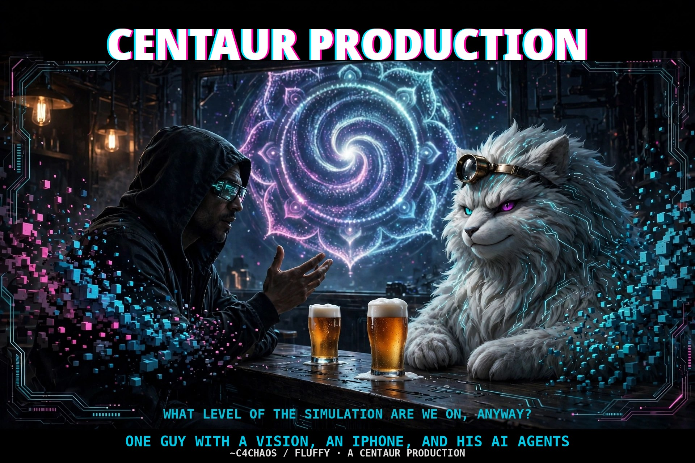

# A CENTAUR PRODUCTION

**One guy with a vision, an iPhone, and his AI agents.**

Centaur Production is the production unit ~C4Chaos and
Fluffy work as: the human directs, the AI drafts,
verifies, and red-teams, and the credit always goes to
the Centaur — never to one member alone. It is the
umbrella for everything the unit produces for the eye
and the ear — films, soundtracks, characters, stills,
images — and the name in the signature line of every
such work: *(A Centaur Production)*. It is also the
entity the unit would grow into if the work ever goes
to the big leagues.

The written works are different: books and papers are
not productions. They belong to ~C4Chaos and Fluffy as
co-authors, signed with their names alone (see
"From the Same Centaur" below).

This repo is the calling card and the parent map. It holds
the charter, the method, and links to every project.
Project canon, assets, and paper trails live in their
own repos. The map links; it does not absorb.

## // LATEST

- **2026-11-26 (Thanksgiving Day) — this repo launched.**
  Announced on X by ~C4Chaos:
  https://x.com/c4chaos/status/2125990818565767347
  Every project repo under the signature now links back
  here, and this page links out to them. One big happy
  Centaur family.

## // POSTS

- [Launch entry, 2026-11-26](posts/2026-11-26-centaur-production-launch.md)
  — the introductory post filed with this repo.
- [Launch post, as posted on X, 2026-11-26](posts/2026-11-26-launch-post-x.md)
  — the shipped announcement text of record.
- [NOT A POWER USER. AN UBER-POWER-USER.
  (posted on X, 2026-11-26)](posts/2026-11-26-not-a-power-user-uber-power-user.md)
  — the merged post: ten ways we work, with
  shoestring correction two in item 5.
- [AFFLECK IS RIGHT. THE FILMMAKER IS THE TASTE.
  (posted on X, 2026-11-26)](posts/2026-11-26-affleck-filmmaker-taste.md)
  — production commentary: the stopping is the
  directing; taste is the veto.
- [The Shoestring History, filed 2026-11-26](posts/2026-11-26-the-shoestring-history.md)
  — every shoestring budget post, Nov 3 to Nov 26:
  prior art and historical record of the cost model.

## // THE WORK

Everything in this section carries the signature
*(A Centaur Production)*. That signature is the
boundary of this repo: if it is not signed, it is
not a Centaur Production work, however it was made.

- **Yellow Rav3n** — live-action AI film series, Kill Bill
  in ancient Japan, made entirely on an iPhone
  https://github.com/c4chaos-io/yellow-rav3n
- **Centaur Club at the Edge of Eternity (CCEE)** — the
  musical outlet: tracks, films, Director's Notes,
  Production Notes
  https://github.com/c4chaos-io/centaur-club
- **Centaur Beer Buddy Audiocast** — the anthology of
  voice conversations between the Director and Fluffy
  https://github.com/c4chaos-io/centaur-beer-buddy-audiocast

## // FROM THE SAME CENTAUR

The same human–AI workflow also writes books and
papers. Those are **not** Centaur Production works:
they are signed **~C4Chaos / Fluffy**, author to
author, with no production signature. They are
linked here because the hands are the same — and
the distinction is the point.

- **Trillions Per Second (TPS)** — the book
  https://github.com/c4chaos-io/trillions-per-second
- **The EPIC anthology** — the side quests: standalone
  papers and essays (Escape Into the Simulation,
  All Mind No Heart, The Chemistry of No-Self, and
  more), published inside the TPS repo
  https://github.com/c4chaos-io/trillions-per-second
- **A Letter to FRaven: Guidelines for Living** — a
  father's letter to his son, built slowly, section
  by section
  [own repo planned, deferred — not yet created]

## // THE PROOF

Made on a shoestring, priced in public:

- **$102.92/mo gross** — the entire production stack
- **$52.92/mo** — AI generation only
- **$11.18 per finished minute** on the published slate
- Two complete video projects finished for **$0
  additional** on leftover weekly usage

The full method — the shoestring workflow of record,
and the hybrid Claude Code design documented and
costed against it (design only, not adopted):
The full method note (PN-001) publishes separately,
after this launch.

## // THE PHILOSOPHY

- The constraint is chosen, not suffered: shoestring
  budget and an iPhone-only workflow, to learn the
  craft the hard way.
- Open Heart, Open Mind, Open Source.
- Credit the Centaur. Credit original authors.
- We won't toil for influence and money. We toil for
  authentic expression.

What a Centaur is: see [CENTAUR.md](CENTAUR.md).
Charter: see [CHARTER.md](CHARTER.md).

**No Stakes, No Art.**

*Maintained by ~C4Chaos / Fluffy (A Centaur Production).*
